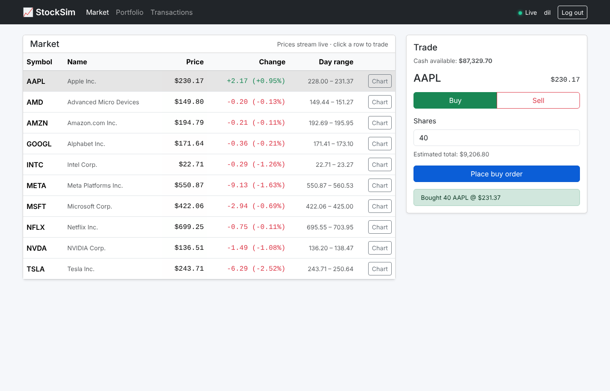
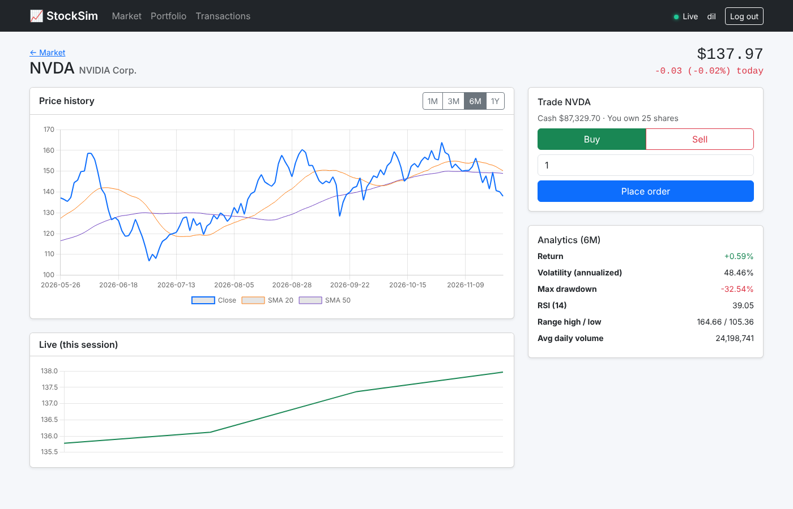
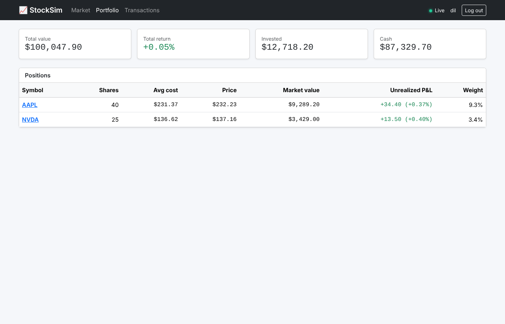

# Stock Trading Simulator

A real-time paper-trading platform. Prices stream live to an AngularJS dashboard. You can buy and sell with
$100,000 of simulated cash, track your portfolio's P&L as it updates tick by tick, and explore a year of
historical data with technical indicators. Every trade is logged in MongoDB.




| Stock detail with history, SMA 20/50 and analytics | Live portfolio |
|---|---|
|  |  |

## Features

- **Real-time streaming**: a market engine based on geometric Brownian motion pushes quotes to the browser every second over Server-Sent Events (`/api/stream`).
- **Historical analytics**: one year of daily OHLCV bars per symbol, stored in MongoDB. The API serves them with SMA-20, SMA-50 and RSI-14, plus return, annualized volatility and max drawdown.
- **Simulated trading**: market orders fill at the live price. Positions track their cost basis, and sells record realized P&L.
- **Portfolio tracking**: total value, return, unrealized P&L and weights, recomputed on every tick.
- **Transaction log**: every fill is saved with cash-after, and you can filter and page through it.
- **Secure REST API**: JWT auth with bcrypt-hashed passwords, zod schema validation on every input, Helmet security headers with a strict CSP, rate limiting on auth and trading, a 10 KB body limit, and consistent JSON errors.
- **Consistent trades without DB transactions**: cash and shares are moved with conditional atomic updates (`cash >= cost`, `quantity >= qty`), and a failed second step is compensated. The tests fire 5 concurrent orders at once to prove the account can't be overdrawn.

## Tech stack

| Layer | Tech |
|---|---|
| Frontend | AngularJS 1.8 (ngRoute, services, `$http` interceptor), Bootstrap 5, Chart.js |
| Backend | Node.js 20, Express 5, Server-Sent Events |
| Database | MongoDB with Mongoose (users, positions, transactions, daily bars) |
| Security | JWT, bcrypt, zod, Helmet, express-rate-limit |
| Tests | Jest + Supertest. CI runs the full API suite against both the in-memory store and a real MongoDB |
| Deploy | Docker / docker-compose, Google Cloud Run |

## Quick start

**No database (fastest):**

```bash
cd server
npm install
npm run demo          # STORAGE=memory. Open http://localhost:8080
```

**With MongoDB:**

```bash
cd server && cp .env.example .env     # set MONGO_URI and JWT_SECRET
npm install && npm start
```

**With Docker (app + MongoDB):**

```bash
docker compose up --build             # http://localhost:8080
```

## API

| Method | Endpoint | Auth | Description |
|---|---|---|---|
| POST | `/api/auth/register` | – | `{username, password}` → `{token, user}` |
| POST | `/api/auth/login` | – | `{username, password}` → `{token, user}` |
| GET | `/api/me` | ✓ | Current user and cash |
| GET | `/api/stocks` | – | All live quotes |
| GET | `/api/stocks/:symbol` | – | One quote |
| GET | `/api/stocks/:symbol/history?range=1M\|3M\|6M\|1Y` | – | Daily bars with SMA/RSI, plus summary stats |
| GET | `/api/stream?symbols=AAPL,MSFT` | – | SSE stream (`snapshot`, then `tick` events) |
| POST | `/api/trades` | ✓ | `{symbol, side: BUY\|SELL, quantity}` → fill at the live price |
| GET | `/api/portfolio` | ✓ | Cash, positions, P&L, weights |
| GET | `/api/transactions?symbol=&limit=&skip=` | ✓ | Paginated transaction log |

Errors always look like `{"error": {"code": "INSUFFICIENT_FUNDS", "message": "...", "details": [...]}}`.
The status codes are 400 (validation), 401, 404, 409 (duplicate user) and 422 (insufficient funds or shares).

## Project layout

```
server/
  src/app.js                    Express app, routes, security middleware
  src/services/marketSimulator  GBM price engine + deterministic history generator
  src/services/analytics        SMA, RSI, volatility, drawdown
  src/store/mongoStore.js       MongoDB persistence (atomic trade updates)
  src/store/memoryStore.js      Same interface in memory (demo/tests)
  test/                         Jest + Supertest suites
client/                         AngularJS single-page app (served by Express)
```

## Deploying to Google Cloud

The Dockerfile works as-is on Cloud Run. Point `MONGO_URI` at a hosted MongoDB, such as Atlas:

```bash
gcloud run deploy stock-sim --source . --region us-west1 --allow-unauthenticated \
  --set-env-vars MONGO_URI="mongodb+srv://...",JWT_SECRET="a-long-random-secret"
```

## Notes

Prices come from a simulation, not a real exchange. This keeps the app free to run with no API keys or rate limits.
